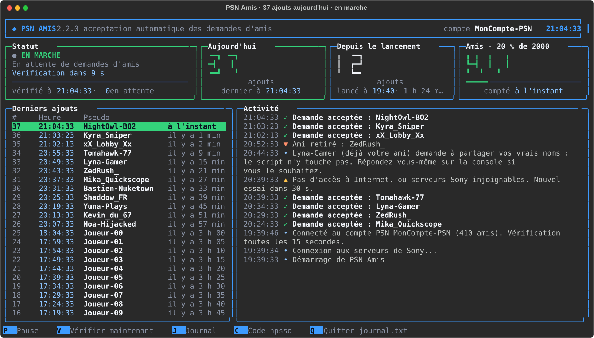

# PSN Amis

**Accepts PlayStation Network friend requests for you, and shows everything in a colourful console.**

[](https://github.com/LASCAMPIA67/psn-amis/actions/workflows/verification.yml)
[](https://github.com/LASCAMPIA67/psn-amis/releases/latest)
[](LICENSE)


🇫🇷 [Lire cette page en français](README.md)

> [!NOTE]
> The program itself speaks French: its screens, messages and settings file are in French. This page explains everything you need to use it anyway.



## What PSN Amis does

As soon as someone sends you a friend request on PlayStation Network, PSN Amis accepts it for you within seconds, without opening your console or the PS App. It runs in a window on your PC, for as long as you leave it open, and shows what it is doing:

- **It accepts incoming friend requests** every 15 seconds, one by one, with a short pause between each.
- **It shows everything live**: status, today's additions and removals, additions since launch with their hourly rate, your friend count against the 2,000 limit, the latest additions with a 24-hour histogram, and a scrollable activity feed.
- **It recounts your friends** with Sony on every check and notes each friend who is gone (« ▼ Ami retiré »), including those who left while PSN Amis was closed.
- **It pauses when you want**: manually, for 5, 10 or 30 minutes, or automatically after a chosen number of additions. While paused, it lists who is waiting.
- **It warns you** with a Windows notification when it needs you (code to renew, full friend list, long outage), and can beep on every addition.
- **It logs everything in `journal.txt`**, with date and time, and shows a summary of the last 7 days.
- **It never stops on its own.** Internet outage, Sony servers down, expired code, full friend list… it explains what is happening, waits, and retries.
- **It stays light**: low priority, two requests every 15 seconds.

What it **never** does: remove a friend, accept a real-name sharing request, send anything anywhere other than Sony (except the version check, off by default), or display your sign-in code.

## Requirements

- A PC running **Windows 10 or 11**. [Windows Terminal](https://aka.ms/terminal) is recommended.
- **Your own PlayStation Network account.** PSN Amis connects to the account whose code you give it.
- [**uv**](https://docs.astral.sh/uv/), free: it installs Python 3.15 and the libraries inside the PSN Amis folder. In PowerShell:

  ```powershell
  winget install --id=astral-sh.uv -e
  ```

## Installation

1. Download the [latest release](https://github.com/LASCAMPIA67/psn-amis/releases/latest) (`Source code (zip)`) and extract it anywhere, for example `Documents\PSN Amis`.
2. Double-click **`Lancer PSN Amis.cmd`** (« Launch PSN Amis »). The first time, it installs Python and the libraries, then asks for your npsso code (next section).
3. Optional: double-click **`Raccourcis PSN Amis.cmd`** to add a desktop shortcut with its icon and, if you want, start PSN Amis minimized with Windows. Choice 3 removes these shortcuts.

**To update:** quit PSN Amis (<kbd>Q</kbd> twice), extract the new version over the old one, and launch it again. Your code, `journal.txt`, `reglages.toml` and `amis.json` are kept.

**To uninstall:** remove the shortcuts (choice 3 in `Raccourcis PSN Amis.cmd`), delete the folder, and delete **PSN Amis/npsso** from **Control Panel › Credential Manager › Windows Credentials**.

## First time: connect your PlayStation account

PSN Amis needs your **npsso code**: 64 letters and digits that Sony gives your browser when you are signed in to playstation.com. It works like a key to your account and stays valid for about two months. **It decides which account is connected.**

> [!WARNING]
> Do not do this while your screen is shared or recorded. Never give this code to anyone: whoever has it has your account.

1. In your browser, sign in to [playstation.com](https://www.playstation.com).
2. In the same browser, open <https://ca.account.sony.com/api/v1/ssocookie>. The page shows a line like `{"npsso":"aB3x…"}`.
3. Double-click the long string of letters and digits and copy it (<kbd>Ctrl</kbd> + <kbd>C</kbd>).
4. In the PSN Amis window, paste it at the « Collez votre code npsso » prompt (<kbd>Ctrl</kbd> + <kbd>V</kbd> or right-click), then press <kbd>Enter</kbd>. Nothing is shown while you type; that is normal.

The code is stored, encrypted with your Windows session, in the **Windows Credential Manager**. With `coffre_windows = false` in `reglages.toml`, it goes to `npsso.txt` instead, readable only by your Windows account. It is never displayed, never logged, and Git ignores `npsso.txt`. An existing `npsso.txt` is moved into the Credential Manager at startup, then deleted once the code reads back correctly.

**To switch accounts or renew the code:** press <kbd>C</kbd> in the dashboard and paste the new code. When the code expires, a red **« Action nécessaire »** panel guides you, and a Windows notification warns you.

## Using it

| Key | Action |
| --- | --- |
| <kbd>P</kbd> | pause or resume; while paused, the « Demandes en attente » panel lists waiting requests |
| <kbd>1</kbd> <kbd>2</kbd> <kbd>3</kbd> | pause for 5, 10 or 30 minutes, then resume automatically |
| <kbd>V</kbd> | check requests and recount friends now |
| <kbd>J</kbd> | open `journal.txt` in Notepad |
| <kbd>C</kbd> | change the npsso code (and so the account) |
| <kbd>S</kbd> | turn the beep on every addition on or off (♪ in the header) |
| <kbd>↑</kbd> <kbd>↓</kbd> | scroll the activity feed; <kbd>Page Up</kbd>/<kbd>Page Down</kbd> go faster, <kbd>Home</kbd> returns to the latest |
| <kbd>H</kbd> | help: keys, symbols, and the last 7 days; <kbd>H</kbd> or <kbd>Esc</kbd> closes it |
| <kbd>Q</kbd> twice | quit |

Symbols in the activity feed: ✓ request accepted, ▼ friend removed, ▲ temporary issue (retried automatically), ✗ error. In « Derniers ajouts » (latest additions), a **▼** after a name means that player has since left your friend list.

Command-line options, from the PSN Amis folder in PowerShell:

```powershell
.\.venv\Scripts\python.exe accepter_amis.py --test         # list pending requests, accept nothing
.\.venv\Scripts\python.exe accepter_amis.py --simple       # plain text output, no dashboard
.\.venv\Scripts\python.exe accepter_amis.py --configurer   # save the npsso code, then exit
.\.venv\Scripts\python.exe accepter_amis.py --diagnostic   # also write diagnostic.txt (code always masked)
.\.venv\Scripts\python.exe outils\exporter_journal.py      # export additions and removals to CSV
```

## Settings

On first launch, PSN Amis creates **`reglages.toml`** from `reglages.exemple.toml`. Edit it with Notepad, save, and restart PSN Amis. A misspelled setting is reported in the activity feed and its default value is used.

| Setting | Default | Meaning |
| --- | --- | --- |
| `intervalle_verification` | `15` | seconds between checks (5 to 3600) |
| `pause_entre_acceptations` | `2` | seconds between two acceptances |
| `limite_amis` | `2000` | maximum number of friends on a PSN account |
| `theme` | `"sombre"` | colours: `"sombre"` (dark), `"doux"` (soft) or `"daltonien"` (colour-blind friendly) |
| `notifications` | `true` | Windows notifications for important events |
| `son` | `false` | beep on every addition at startup (key <kbd>S</kbd> toggles it) |
| `pause_apres_ajouts` | `0` | automatic pause after this many additions since the last resume (`0`: never) |
| `liste_noire` | `[]` | blocklist: names never accepted, e.g. `["Spam_42"]` |
| `liste_blanche` | `[]` | allowlist: if not empty, only these names are accepted |
| `verifier_mises_a_jour` | `false` | check GitHub for a newer version at startup |
| `coffre_windows` | `true` | keep the npsso code in the Windows Credential Manager rather than `npsso.txt` |

## Security and privacy

- **Your npsso code never leaves your PC** except to Sony's sign-in servers. It is never displayed or logged; if it ever appeared in a message, it would be replaced by `[code masqué]`.
- **Only Sony's servers** (`sony.com`, `playstation.com`, `playstation.net`) are contacted for your account; any other address is blocked before sending. No telemetry.
- **One exception, off by default:** with `verifier_mises_a_jour = true`, PSN Amis asks GitHub's public API for the latest version number once at startup. The request contains nothing about you.
- **PSN Amis never removes friends** and never accepts a real-name sharing request.
- `journal.txt`, `amis.json` and CSV exports contain player names or IDs: do not publish them. Git ignores them.

See [SECURITY.md](SECURITY.md) (in French) for the full details.

## Limits and disclaimer

PSN Amis relies on [PSNAWP](https://github.com/isFakeAccount/psnawp), an **unofficial** library that talks to Sony like the PS App does. Sony may change its servers without notice, and its terms may not allow automation: an account making too many requests could be suspended. PSN Amis keeps a moderate pace, but **you use it at your own risk**. A PSN account cannot have more than 2,000 friends. PSN Amis runs on Windows only.

## Developers

```shell
uv sync                  # Python 3.15, libraries and dev tools
uv run ruff check .      # lint
uv run ruff format .     # format
uv run pytest            # tests, no Internet or real account needed
```

Contributions are welcome: see [CONTRIBUTING.md](CONTRIBUTING.md) and the [changelog](CHANGELOG.md) (both in French).

## Licence

PSN Amis is released under the [MIT licence](LICENSE). It is affiliated neither with Sony Interactive Entertainment nor with the PSNAWP project. « PlayStation », « PlayStation Network », « PS4 » and « PS5 » are trademarks of Sony Interactive Entertainment.
