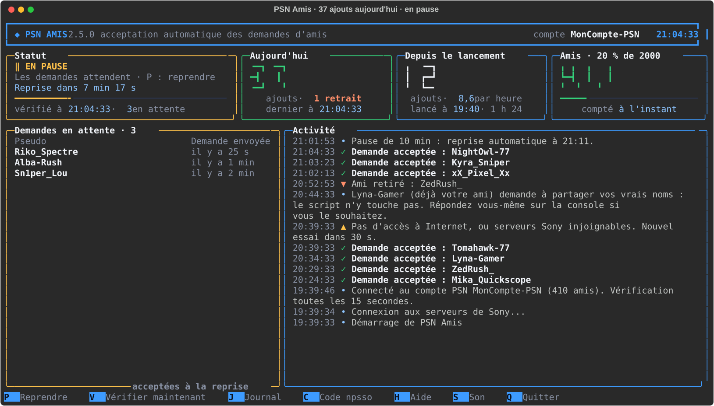
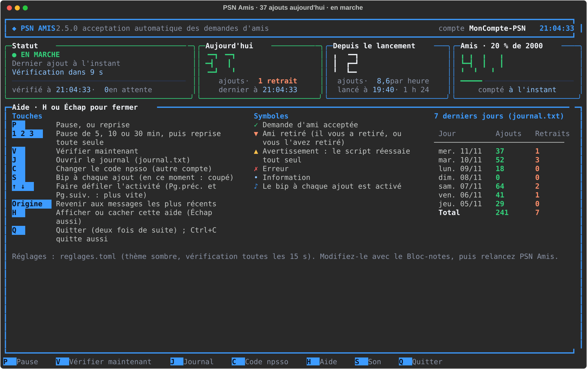
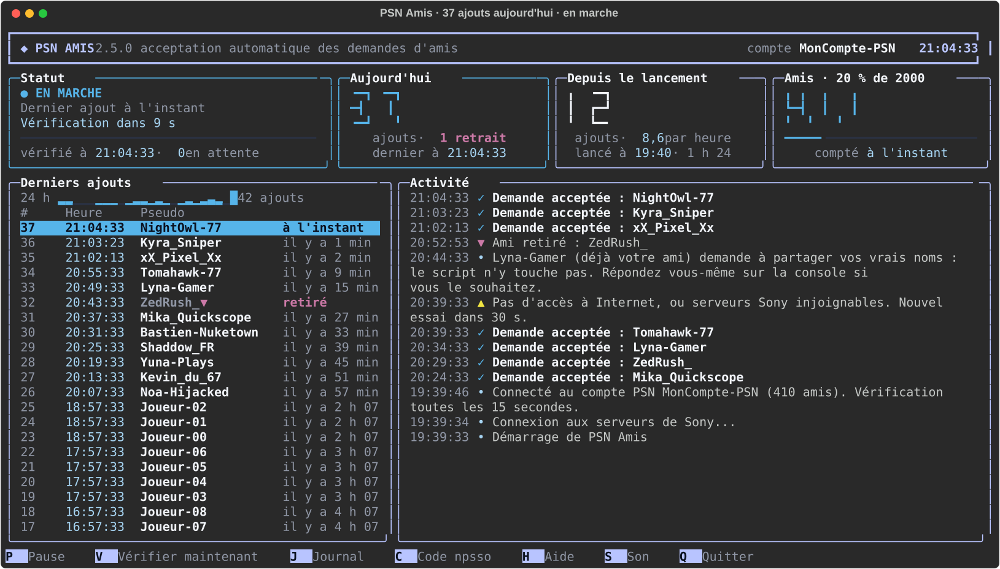

# PSN Amis

**Accepte à ta place les demandes d'amis PlayStation Network, et te montre tout dans une console en couleur.**

[](https://github.com/LASCAMPIA67/psn-amis/actions/workflows/verification.yml)
[](https://github.com/LASCAMPIA67/psn-amis/releases/latest)
[](LICENSE)


[](https://github.com/astral-sh/uv)
[](https://github.com/astral-sh/ruff)

🇬🇧 [Read this page in English](README.en.md)


## Sommaire

- [Ce que fait PSN Amis](#ce-que-fait-psn-amis)
- [Ce qu'il te faut](#ce-quil-te-faut)
- [Installation](#installation)
- [La première fois : connecter ton compte PlayStation](#la-première-fois--connecter-ton-compte-playstation)
- [Utilisation](#utilisation)
- [Toutes les 15 secondes](#toutes-les-15-secondes)
- [Réglages](#réglages)
- [Sécurité et vie privée](#sécurité-et-vie-privée)
- [Limites et avertissement](#limites-et-avertissement)
- [Dépannage](#dépannage)
- [Questions fréquentes](#questions-fréquentes)
- [Pour les développeurs](#pour-les-développeurs)
- [Contribuer](#contribuer)
- [Licence et avertissement](#licence-et-avertissement)

## Ce que fait PSN Amis

Dès que quelqu'un t'envoie une demande d'ami sur PlayStation Network, PSN Amis l'accepte pour toi, en quelques secondes, sans que tu aies à ouvrir la console ou l'appli PS App. Il tourne dans une fenêtre sur ton PC, que tu laisses ouverte aussi longtemps que tu veux, et il te montre ce qu'il fait :

- **Il accepte les demandes d'amis reçues**, toutes les 15 secondes, une par une, avec une petite pause entre chaque.
- **Il te montre tout en direct** dans une console en couleur : le statut, les ajouts et les retraits du jour, les ajouts depuis le lancement avec leur rythme par heure, le nombre d'amis avec une jauge sur 2 000, les derniers ajouts avec un histogramme des 24 dernières heures, et un fil d'activité que tu peux faire défiler.
- **Il recompte tes amis** auprès de Sony à chaque vérification, et note chaque ami qui n'y est plus (« ▼ Ami retiré »), même ceux partis pendant que PSN Amis était fermé.
- **Il se met en pause quand tu veux** : à la main, pour 5, 10 ou 30 minutes, ou tout seul après un nombre d'ajouts choisi. Pendant la pause, il te montre qui attend.
- **Il te prévient** par une bulle Windows quand il a besoin de toi (code à renouveler, liste pleine, longue coupure), et peut biper à chaque ajout.
- **Il écrit tout dans `journal.txt`**, avec la date et l'heure, et te montre le bilan des 7 derniers jours.
- **Il ne s'arrête jamais tout seul.** Coupure Internet, serveurs Sony en panne, code expiré, liste d'amis pleine… il explique ce qui se passe, attend, et réessaie.
- **Il reste léger** : priorité basse, deux requêtes toutes les 15 secondes. Les autres programmes passent avant lui.
- **Il s'adapte à la fenêtre** : grand écran, fenêtre réduite ou zoom (<kbd>Ctrl</kbd> + molette), l'affichage se réorganise et les messages restent entiers.

Et ce qu'il ne fait **jamais** : retirer un ami, accepter une demande de partage du vrai nom, envoyer quoi que ce soit ailleurs que chez Sony (sauf la vérification de version, coupée au départ), ou afficher ton code de connexion.

## Ce qu'il te faut

- Un PC sous **Windows 10 ou 11**. [Windows Terminal](https://aka.ms/terminal), fourni avec Windows 11, est conseillé pour l'affichage.
- **Un compte PlayStation Network** : le tien. PSN Amis se connecte au compte dont tu lui donnes le code (voir [La première fois](#la-première-fois--connecter-ton-compte-playstation)) ; rien dans le programme n'est lié au compte de l'auteur.
- [**uv**](https://docs.astral.sh/uv/), gratuit : il installe tout seul Python 3.15 et les bibliothèques, dans le dossier de PSN Amis, sans toucher au reste de ton PC. Dans PowerShell :

  ```powershell
  winget install --id=astral-sh.uv -e
  ```

  Ou, sans winget : `powershell -ExecutionPolicy ByPass -c "irm https://astral.sh/uv/install.ps1 | iex"`. Ferme puis rouvre la fenêtre PowerShell après l'installation.

## Installation

1. Télécharge la [dernière version publiée](https://github.com/LASCAMPIA67/psn-amis/releases/latest) (`Source code (zip)`), puis décompresse-la où tu veux, par exemple dans `Documents\PSN Amis` : clic droit sur le fichier téléchargé, puis **Extraire tout**.
2. Double-clique sur **`Lancer PSN Amis.cmd`**. La première fois, il installe Python et les bibliothèques (quelques dizaines de secondes, avec Internet), puis te demande ton code npsso : c'est l'étape suivante. Les fois suivantes, il vérifie en un instant que tout est à jour, puis ouvre le tableau de bord.
3. Facultatif : double-clique sur **`Raccourcis PSN Amis.cmd`** pour mettre PSN Amis sur ton Bureau, avec son icône, et, si tu veux, l'ouvrir tout seul (fenêtre réduite) à chaque démarrage de Windows. Le même fichier retire ces raccourcis.

> [!NOTE]
> Comme pour tout fichier téléchargé, Windows peut demander une confirmation à la première ouverture d'un `.cmd` : clique sur **Exécuter**. Si rien ne se passe, fais un clic droit sur le fichier, **Propriétés**, coche **Débloquer**, puis réessaie.

**Pour le mettre à jour :** quitte PSN Amis (<kbd>Q</kbd> deux fois), télécharge la nouvelle version et décompresse-la au même endroit, en remplaçant les fichiers, puis relance : le lanceur met à jour les bibliothèques tout seul. Ton code, `journal.txt`, `reglages.toml` et `amis.json` ne sont pas dans l'archive : ils sont gardés.

**Pour le désinstaller :** quitte PSN Amis, lance `Raccourcis PSN Amis.cmd` et choisis **Retirer les raccourcis** si tu en as créé, puis supprime son dossier. Ton code reste dans le Gestionnaire d'identification de Windows : pour l'effacer, ouvre **Panneau de configuration › Gestionnaire d'identification › Informations d'identification Windows** et supprime **PSN Amis/npsso**. Rien d'autre n'est installé, à part uv et le Python qu'il a téléchargé (`uv python uninstall 3.15` pour s'en défaire aussi).

**Depuis le code source :** `git clone https://github.com/LASCAMPIA67/psn-amis.git`, puis le même double-clic.

## La première fois : connecter ton compte PlayStation

PSN Amis parle à Sony en ton nom. Pour cela, il lui faut ton **code npsso** : une suite de 64 lettres et chiffres que Sony donne à ton navigateur quand tu es connecté à playstation.com. Ce code vaut une clé de ton compte, et il reste valable environ deux mois.

C'est à faire une seule fois (puis tous les deux mois environ), et **c'est ce qui décide du compte connecté** : donne le code de ton compte, et c'est ton compte que PSN Amis gère.

> [!WARNING]
> Ne fais pas cette étape si ton écran est partagé ou enregistré : le code y serait visible. Ne le donne à personne et ne le colle nulle part ailleurs : qui a ce code a ton compte.

1. Dans ton navigateur, connecte-toi sur [playstation.com](https://www.playstation.com) avec le compte que les joueurs doivent ajouter.
2. Dans le même navigateur, ouvre <https://ca.account.sony.com/api/v1/ssocookie>. La page affiche une ligne du genre `{"npsso":"aB3x…"}`.
3. Double-clique sur la longue suite de lettres et de chiffres : elle se sélectionne en entier. Copie-la (<kbd>Ctrl</kbd> + <kbd>C</kbd>).
4. Dans la fenêtre de PSN Amis, colle-la (<kbd>Ctrl</kbd> + <kbd>V</kbd>, ou clic droit) à l'invite « Collez votre code npsso », puis appuie sur <kbd>Entrée</kbd>. Rien ne s'affiche pendant la saisie, c'est normal. PSN Amis vérifie le code, l'enregistre et se connecte : ton pseudo apparaît en haut à droite du tableau de bord.

**Où est gardé le code ?** Dans le **Gestionnaire d'identification de Windows**, le coffre où Windows range aussi les mots de passe de ses applications. Il y est chiffré avec ta session Windows : aucun fichier à protéger, et un autre compte Windows du même PC ne peut pas le lire. Si tu préfères un fichier, mets `coffre_windows = false` dans `reglages.toml` : le code va alors dans `npsso.txt`, lisible seulement par ton compte Windows. Dans tous les cas, il n'est jamais affiché, jamais écrit dans le journal, et Git ignore `npsso.txt` : il ne peut pas être publié par erreur.

Si tu avais déjà un `npsso.txt` (version 2.4 ou avant, ou code mis à la main avec le Bloc-notes), PSN Amis le range dans le coffre au démarrage, vérifie qu'il s'y relit bien, puis supprime `npsso.txt`.

**Pour changer de compte, ou mettre un nouveau code :** appuie sur <kbd>C</kbd> dans le tableau de bord et colle le nouveau code. PSN Amis se reconnecte aussitôt à ce compte. Quand le code expire, un panneau rouge **« Action nécessaire »** te le dit et te guide, et une bulle Windows te prévient même si la fenêtre est cachée.


## Utilisation

Double-clique sur **`Lancer PSN Amis.cmd`** (ou sur le raccourci du Bureau) et laisse la fenêtre ouverte tant que tu veux que les demandes soient acceptées. Ce que tu vois :

- **En haut :** la version, le compte connecté et l'heure. Un **♪** indique que le bip à chaque ajout est activé.
- **Statut :** le voyant vert bat quand tout va bien, avec le temps écoulé depuis le dernier ajout et le compte à rebours jusqu'à la prochaine vérification. En cas de souci, la couleur change et une phrase dit quoi faire.
- **Aujourd'hui :** les ajouts du jour, en gros chiffres, et les amis retirés du jour. Ces compteurs sont relus dans le journal au démarrage : ils ne repartent pas à zéro si tu relances.
- **Depuis le lancement :** les ajouts de cette session, et leur rythme par heure.
- **Amis :** ton nombre d'amis selon Sony, avec une jauge qui passe à l'orange puis au rouge en approchant de la limite de 2 000.
- **Derniers ajouts :** en haut, un histogramme des 24 dernières heures (une barre par heure, la plus récente à droite) ; puis l'heure et le pseudo de chacun. Un nouvel ajout reste surligné en vert dix secondes. Un **▼** orange après un pseudo signale un joueur qui a depuis quitté ta liste d'amis.
- **Activité :** ✓ vert pour un ajout, ▼ orange pour un ami retiré, ▲ jaune pour un souci passager, ✗ rouge pour un problème. Chaque message est affiché en entier ; ceux des jours précédents sont datés. Les flèches font remonter dans l'historique.

Le **titre de la fenêtre** indique le nombre d'ajouts du jour, visible depuis la barre des tâches.

Si la fenêtre est petite, ou si tu zoomes, l'affichage se resserre : cartes compactes, puis simple résumé.


### La pause

<kbd>P</kbd> met en pause : les nouvelles demandes attendent, et le panneau **Demandes en attente** remplace « Derniers ajouts » avec le pseudo de chacun et depuis quand il attend. <kbd>P</kbd> à nouveau, et elles sont toutes acceptées.

<kbd>1</kbd>, <kbd>2</kbd> ou <kbd>3</kbd> font une **pause de 5, 10 ou 30 minutes**, puis reprennent tout seuls ; le compte à rebours de la reprise s'affiche dans le statut. Le réglage `pause_apres_ajouts` met aussi en pause tout seul après un certain nombre d'ajouts.



### Touches

| Touche | Action |
| --- | --- |
| <kbd>P</kbd> | mettre en pause, ou reprendre |
| <kbd>1</kbd> <kbd>2</kbd> <kbd>3</kbd> | pause de 5, 10 ou 30 minutes, puis reprise automatique |
| <kbd>V</kbd> | vérifier les demandes et recompter les amis tout de suite |
| <kbd>J</kbd> | ouvrir `journal.txt` dans le Bloc-notes |
| <kbd>C</kbd> | changer le code npsso (donc de compte), sans quitter |
| <kbd>S</kbd> | activer ou couper le bip à chaque ajout |
| <kbd>↑</kbd> <kbd>↓</kbd> | faire défiler l'activité ; <kbd>Pg.préc.</kbd> et <kbd>Pg.suiv.</kbd> vont plus vite, <kbd>Origine</kbd> revient aux plus récents |
| <kbd>H</kbd> | afficher l'aide : touches, symboles, et le bilan des 7 derniers jours. <kbd>H</kbd> ou <kbd>Échap</kbd> la referme |
| <kbd>Q</kbd> deux fois | quitter. Fermer la fenêtre fonctionne aussi, et l'arrêt est noté dans le journal |



### Les bulles Windows

PSN Amis affiche une bulle de notification Windows seulement quand il a besoin de toi : code npsso à renouveler, liste d'amis pleine, ou Sony injoignable depuis plusieurs minutes. Pas de bulle pour chaque ajout : pour ça, il y a le bip (<kbd>S</kbd>). Pour couper les bulles : `notifications = false` dans `reglages.toml`.

### Exporter le journal

Pour ouvrir l'historique dans Excel ou LibreOffice Calc, depuis le dossier de PSN Amis dans PowerShell :

```powershell
.\.venv\Scripts\python.exe outils\exporter_journal.py                       # tout l'historique
.\.venv\Scripts\python.exe outils\exporter_journal.py --depuis 2026-11-01   # à partir d'une date
```

Le fichier `export-journal-AAAA-MM-JJ.csv` contient une ligne par ajout ou retrait (date, heure, événement, pseudo).

### En ligne de commande

Dans PowerShell, depuis le dossier de PSN Amis :

```powershell
.\.venv\Scripts\python.exe accepter_amis.py --test         # affiche les demandes en attente, sans rien accepter
.\.venv\Scripts\python.exe accepter_amis.py --simple       # affichage texte simple, sans tableau de bord
.\.venv\Scripts\python.exe accepter_amis.py --configurer   # enregistre le code npsso, puis s'arrête
.\.venv\Scripts\python.exe accepter_amis.py --diagnostic   # écrit aussi diagnostic.txt (détails techniques)
```

`--diagnostic` peut s'ajouter aux autres options, et aussi au lanceur : `& ".\Lancer PSN Amis.cmd" --diagnostic`.

## Toutes les 15 secondes

1. **Les demandes d'amis reçues sont acceptées**, une par une, avec 2 secondes de pause entre chaque. Une demande que Sony refuse (par exemple parce que la liste d'amis de l'autre joueur est pleine) est réessayée 30 minutes plus tard, sans bloquer les suivantes. Les joueurs de ta liste noire sont ignorés (voir [Réglages](#réglages)).
2. **La liste d'amis est recomptée.** Chaque ami qui n'y est plus donne une ligne « ▼ Ami retiré : pseudo », qu'il t'ait retiré ou que tu l'aies retiré toi-même : Sony ne dit pas qui l'a fait. La liste est gardée dans `amis.json` : au démarrage suivant, les amis partis pendant que PSN Amis était fermé sont signalés (« Ami retiré pendant l'arrêt »).
3. **Les demandes de partage du vrai nom**, envoyées par des joueurs déjà amis, sont mises à part : jamais acceptées (elles dévoileraient ton identité), signalées une seule fois. Réponds-y toi-même sur la console si tu le souhaites.

Si ta liste d'amis est pleine, PSN Amis le dit clairement et reprend tout seul dès qu'une place se libère. Il ne retire jamais d'amis : c'est à toi de le faire, sur la console ou dans l'appli PS App.

Tout est écrit dans `journal.txt` (date, heure, pseudo). Quand ce fichier dépasse 1 Mo, il est archivé (`journal.txt.1`, jusqu'à 3 archives).

## Réglages

Au premier lancement, PSN Amis crée **`reglages.toml`** dans son dossier, à partir de `reglages.exemple.toml`. Ouvre-le avec le Bloc-notes, change ce que tu veux, enregistre, puis relance PSN Amis. Chaque réglage y est expliqué ; un réglage mal écrit est signalé dans l'activité au démarrage, et sa valeur par défaut est utilisée.

| Réglage | Par défaut | Rôle |
| --- | --- | --- |
| `intervalle_verification` | `15` | secondes entre deux vérifications (de 5 à 3600) |
| `pause_entre_acceptations` | `2` | secondes de pause entre deux acceptations |
| `limite_amis` | `2000` | nombre maximum d'amis sur un compte PSN |
| `theme` | `"sombre"` | couleurs : `"sombre"`, `"doux"` (plus calmes) ou `"daltonien"` (bleu, jaune, orange) |
| `notifications` | `true` | bulles Windows pour les événements importants |
| `son` | `false` | bip à chaque ajout au démarrage (la touche <kbd>S</kbd> le change en cours de route) |
| `pause_apres_ajouts` | `0` | pause automatique après ce nombre d'ajouts depuis la dernière reprise (`0` : jamais) |
| `liste_noire` | `[]` | pseudos à ne jamais accepter, par exemple `["Spam_42", "Indesirable"]` |
| `liste_blanche` | `[]` | si elle n'est pas vide, seuls ces pseudos sont acceptés |
| `verifier_mises_a_jour` | `false` | chercher une nouvelle version de PSN Amis sur GitHub au démarrage |
| `coffre_windows` | `true` | garder le code npsso dans le Gestionnaire d'identification de Windows plutôt que dans `npsso.txt` |

Les demandes ignorées par la liste noire ou blanche restent sur ton compte : tu peux toujours y répondre toi-même.



Garde un rythme raisonnable : PSNAWP, la bibliothèque utilisée, se limite elle-même à 300 requêtes par quart d'heure. Avec les réglages par défaut, PSN Amis en fait 8 par minute quand il ne se passe rien, plus 2 par acceptation. Les réglages plus techniques (délais réseau, attentes après une erreur) sont en haut de `moteur.py`.

## Sécurité et vie privée

- **Ton code npsso ne quitte jamais ton PC**, sauf vers les serveurs d'authentification de Sony. Il est gardé chiffré dans le coffre de Windows, n'est ni affiché, ni journalisé : s'il apparaissait par accident dans un message, il serait remplacé par `[code masqué]`.
- **Seuls les serveurs de Sony** (`sony.com`, `playstation.com`, `playstation.net`) sont contactés pour ton compte. Toute autre adresse est bloquée avant l'envoi. Aucune télémétrie.
- **Une seule exception, coupée au départ :** avec `verifier_mises_a_jour = true`, PSN Amis demande une fois au démarrage, à l'API publique de GitHub, le numéro de la dernière version. Cette requête ne contient ni ton code, ni ton pseudo, ni rien d'autre.
- **PSN Amis ne retire jamais d'amis** et n'accepte jamais une demande de partage du vrai nom.
- **`journal.txt`, `amis.json` et les exports CSV contiennent des pseudos** ou des identifiants de joueurs : ne les publie pas tels quels. Git les ignore.
- **`diagnostic.txt`** (option `--diagnostic`) contient des détails techniques, avec le code npsso toujours masqué ; relis-le avant de le joindre à un ticket.
- **Si tu partages ou enregistres ton écran**, les pseudos des joueurs acceptés sont visibles ; le code npsso, lui, ne l'est jamais. N'utilise pas l'assistant de connexion (<kbd>C</kbd>) pendant ce temps.
- Une seule copie de PSN Amis tourne à la fois.

Le détail de ce que fait le programme est dans [SECURITY.md](SECURITY.md).

## Limites et avertissement

- PSN Amis utilise [PSNAWP](https://github.com/isFakeAccount/psnawp), une bibliothèque **non officielle** qui parle à Sony comme le fait l'appli PS App. Sony peut changer ses serveurs sans prévenir, et son règlement n'autorise pas forcément l'automatisation : un compte qui fait trop de requêtes peut être suspendu. PSN Amis garde un rythme modéré, mais **tu l'utilises sous ta responsabilité**.
- Un compte PSN ne peut pas avoir plus de 2 000 amis : au-delà, Sony refuse les nouvelles demandes.
- PSN Amis fonctionne sous Windows (il utilise la console Windows pour les touches et l'affichage).
- Il gère un seul compte à la fois. Pour un deuxième compte, fais une deuxième copie du dossier, mets `coffre_windows = false` dans son `reglages.toml` (le coffre est partagé entre les copies), et colle le code de l'autre compte.

## Dépannage

**Un panneau rouge « Action nécessaire » : le code npsso est refusé ou expiré.** C'est normal environ tous les deux mois. Appuie sur <kbd>C</kbd>, et suis les quatre étapes affichées (voir [La première fois](#la-première-fois--connecter-ton-compte-playstation)). PSN Amis reprend tout seul.

**« PSN Amis tourne déjà dans une autre fenêtre. »** Il est déjà ouvert : cherche sa fenêtre dans la barre des tâches. Si tu es sûr qu'il ne tourne nulle part (après un plantage de Windows, par exemple), supprime le fichier `accepter_amis.lock` du dossier, puis relance.

**« Première utilisation : installation des composants » échoue, ou « L'outil uv est introuvable ».** Installe [uv](#ce-quil-te-faut), ferme toutes les fenêtres PowerShell ou de terminal, puis relance `Lancer PSN Amis.cmd`. L'installation a besoin d'Internet.

**Les symboles ou les couleurs s'affichent mal.** Utilise Windows Terminal : **Paramètres › Système › Pour les développeurs › Terminal**, choisis **Terminal Windows**. L'ancienne console de Windows marche aussi, mais avec moins de finesse. Si les couleurs sont difficiles à distinguer, essaie `theme = "daltonien"`.

**« reglages.toml : … (valeur par défaut gardée) » dans l'activité.** Un réglage est mal écrit : ouvre `reglages.toml`, corrige la ligne indiquée (les textes entre guillemets, `true` ou `false` en minuscules), enregistre et relance. Pour repartir de zéro, supprime `reglages.toml` : il est recréé au lancement suivant.

**« Demande de X refusée par Sony ».** Le plus souvent, c'est la liste d'amis de ce joueur qui est pleine : PSN Amis réessaie 30 minutes plus tard, tu n'as rien à faire. Si c'est ta liste qui est pleine, le statut l'indique en rouge.

**« LISTE D'AMIS PLEINE ».** Retire des amis sur la console ou dans l'appli PS App. PSN Amis reprend tout seul dès qu'il y a de la place.

**« Pas d'accès à Internet, ou serveurs Sony injoignables. »** PSN Amis réessaie tout seul, de plus en plus espacé (30 s, 1 min, 2 min, jusqu'à 5 min). <kbd>V</kbd> force un essai immédiat.

**Un « Ami retiré » alors que je n'ai rien fait.** Le joueur t'a retiré de ses amis, ou a été banni. Sony met parfois quelques minutes à refléter un changement.

**Pas de bulle Windows.** Vérifie que `notifications = true` dans `reglages.toml`, et que les notifications ne sont pas coupées dans **Paramètres › Système › Notifications** (ni le mode « Ne pas déranger »). Les bulles apparaissent sous le nom « Windows PowerShell ».

**J'ai mis un nouveau code, mais le compte affiché est l'ancien.** Appuie sur <kbd>C</kbd> et colle le code du bon compte : le pseudo en haut à droite change après la reconnexion. Le code vient du navigateur où tu es connecté : vérifie que c'est le bon compte qui y est ouvert.

**La fenêtre se ferme tout de suite.** Lance `Lancer PSN Amis.cmd` depuis PowerShell pour lire le message : `& ".\Lancer PSN Amis.cmd"`. Le plus souvent, uv manque, ou l'installation n'a pas pu se faire. Pour un problème qui revient, relance avec `--diagnostic` et joins `diagnostic.txt` à un [ticket](https://github.com/LASCAMPIA67/psn-amis/issues).

## Questions fréquentes

**Dois-je donner mon mot de passe PlayStation ?** Non, jamais. PSN Amis ne te demande que le code npsso, que tu copies toi-même depuis ton navigateur. Il ne connaît pas ton mot de passe.

**Est-ce que ça marche avec mon compte, et pas celui de l'auteur ?** Oui : c'est le code npsso que tu colles qui décide du compte. Le dépôt ne contient aucun code, et `npsso.txt` est ignoré par Git. Le pseudo du compte connecté est affiché en haut du tableau de bord.

**PS4 ou PS5 ?** Les deux : les amis sont liés au compte, pas à la console.

**Et si je ferme la fenêtre ?** Plus rien n'est accepté. Relance PSN Amis, et les demandes arrivées entre-temps sont acceptées dans les 15 secondes. Les compteurs du jour sont relus dans le journal, et les amis partis entre-temps sont signalés.

**Puis-je le laisser tourner toute la journée ?** Oui, c'est fait pour. Il renouvelle lui-même ses autorisations auprès de Sony ; seul le code npsso est à refaire tous les deux mois environ. Avec `Raccourcis PSN Amis.cmd`, il peut même s'ouvrir tout seul au démarrage de Windows.

**Comment refuser certains joueurs ?** Ajoute leur pseudo à `liste_noire` dans `reglages.toml`. Leurs demandes ne sont jamais acceptées, et tu restes libre d'y répondre toi-même.

**Pourquoi un fichier `.cmd` et pas un `.exe` ?** Un `.exe` fabriqué à partir d'un script Python est souvent bloqué à tort par les antivirus, et il faudrait le refabriquer à chaque changement. Le `.cmd` lance simplement le programme, dont tu peux lire tout le code.

**Linux ou macOS ?** Pas pour l'instant : le tableau de bord s'appuie sur la console Windows.

## Pour les développeurs

Le projet est géré avec [uv](https://docs.astral.sh/uv/) (Python 3.15, versions figées dans `uv.lock`) et vérifié par [Ruff](https://docs.astral.sh/ruff/) et [pytest](https://docs.pytest.org/).

```shell
uv sync                              # Python 3.15, bibliothèques et outils de développement
uv run ruff check .                  # qualité du code
uv run ruff format .                 # mise en forme
uv run pytest                        # tests, sans Internet ni vrai compte (environ 40 s)
uv run outils/verifier_version.py    # même version partout
uv run outils/captures.py            # redessine les captures d'écran (données inventées)
uv run outils/icone.py               # redessine l'icône
```

| Fichier | Rôle |
| --- | --- |
| `accepter_amis.py` | point d'entrée : options, réglages, verrou, assistant de connexion, fin de session |
| `moteur.py` | Sony : connexion, demandes, acceptations, recomptage ; état partagé ; journal |
| `tableau_de_bord.py` | affichage Rich, thèmes, mise en page selon la taille, clavier |
| `reglages.py` | lecture et vérification de `reglages.toml` |
| `coffre.py` | le code npsso dans le Gestionnaire d'identification de Windows |
| `notifications.py` | bulles Windows et bip |
| `mises_a_jour.py` | vérification de la dernière version sur GitHub (coupée au départ) |
| `Lancer PSN Amis.cmd` | le lanceur à double-cliquer (installe tout la première fois) |
| `Raccourcis PSN Amis.cmd` | raccourcis Bureau et démarrage de Windows |
| `tests/` | tests pytest, avec un faux Sony et un faux coffre en mémoire |
| `outils/` | captures d'écran, icône, raccourcis, export CSV, notes et contrôle de version |
| `docs/images/` | les captures d'écran du README et l'icône |

Les vérifications automatiques tournent sur GitHub à chaque envoi (`verification.yml`) ; une étiquette `vX.Y.Z` publie la version (`publication.yml`). Le détail est dans le [guide de contribution](CONTRIBUTING.md).

## Contribuer

Les idées et les corrections sont les bienvenues ! Lis le [guide de contribution](CONTRIBUTING.md) et le [code de conduite](CODE_OF_CONDUCT.md). Pour une question, passe par les [discussions](https://github.com/LASCAMPIA67/psn-amis/discussions). Les changements de chaque version sont dans le [journal des modifications](CHANGELOG.md).

## Licence et avertissement

PSN Amis est distribué sous [licence MIT](LICENSE).

PSN Amis n'est affilié ni à Sony Interactive Entertainment, ni au projet PSNAWP. « PlayStation », « PlayStation Network », « PS4 » et « PS5 » sont des marques de Sony Interactive Entertainment.
