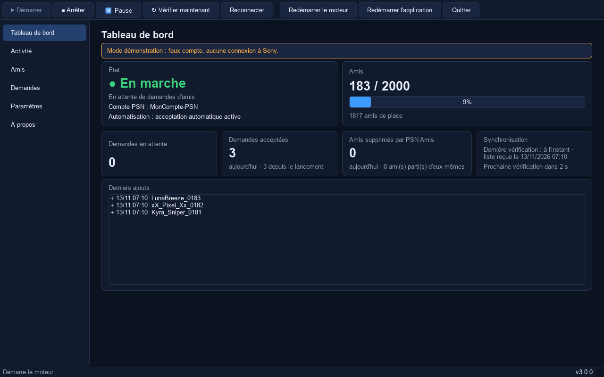
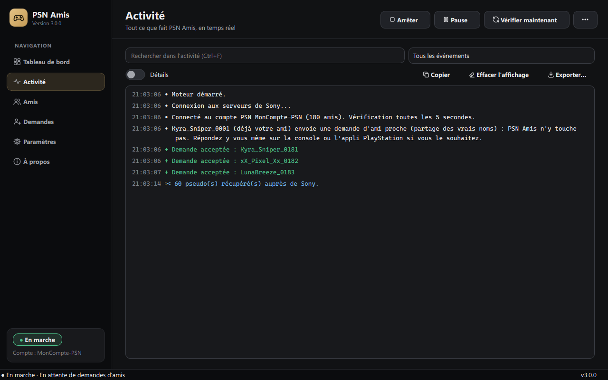
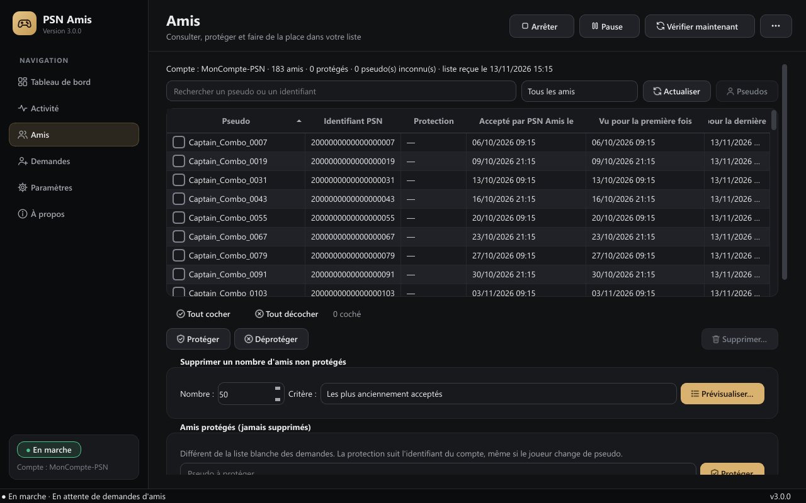
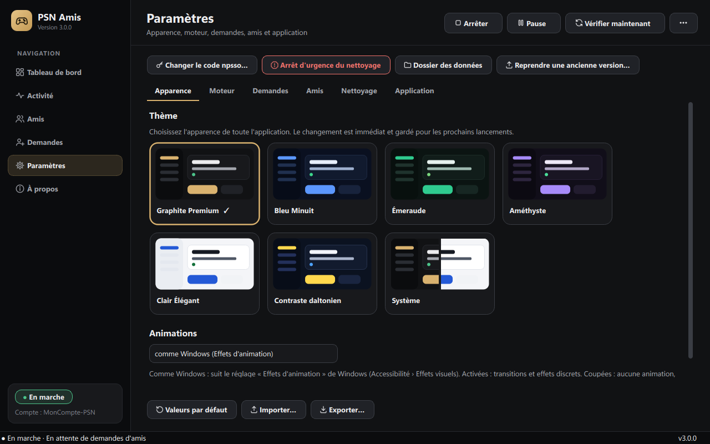

# PSN Amis

**Accepte à ta place les demandes d'amis PlayStation Network, et t'aide à garder de la place dans ta liste d'amis.**

[](https://github.com/LASCAMPIA67/psn-amis/actions/workflows/verification.yml)
[](https://github.com/LASCAMPIA67/psn-amis/releases/latest)
[](LICENSE)

🇬🇧 [Read this page in English](README.en.md)



**[⬇ Télécharger la dernière version](https://github.com/LASCAMPIA67/psn-amis/releases/latest)** (fichier `PSN-Amis-Setup-x.y.z.exe`, Windows 10 et 11, 64 bits)

> PSN Amis est un projet indépendant, **sans lien avec Sony Interactive Entertainment ni PlayStation**. Il utilise une API PlayStation non officielle : lis [Limites et avertissement](#limites-et-avertissement) avant de l'utiliser.

## Sommaire

- [Ce que fait PSN Amis](#ce-que-fait-psn-amis)
- [Installation](#installation)
- [La première fois : connecter ton compte](#la-première-fois--connecter-ton-compte)
- [Utilisation](#utilisation)
- [Gérer tes amis](#gérer-tes-amis)
- [Les amis protégés](#les-amis-protégés)
- [Les demandes d'amis](#les-demandes-damis)
- [Paramètres](#paramètres)
- [Mises à jour](#mises-à-jour)
- [Désinstallation](#désinstallation)
- [Sécurité et vie privée](#sécurité-et-vie-privée)
- [Limites et avertissement](#limites-et-avertissement)
- [Dépannage](#dépannage)
- [Pour les développeurs](#pour-les-développeurs)
- [Contribuer](#contribuer)

## Ce que fait PSN Amis

- **Accepte automatiquement les demandes d'amis** reçues par ton compte PlayStation, toutes les 15 secondes, une par une.
- **Te montre tout ce qu'il fait** : un tableau de bord clair, et une console d'activité en couleur, comme dans les versions précédentes.
- **T'aide à gérer ta liste d'amis** (2 000 au maximum chez Sony) : consulter, rechercher, protéger, supprimer un ami ou plusieurs d'un coup, avec un aperçu et une confirmation à chaque fois.
- **Peut nettoyer la liste pour toi**, si tu l'actives : quand elle atteint un seuil, il propose (ou fait) quelques suppressions, sans jamais toucher à tes amis protégés.
- **Ne touche jamais aux demandes d'ami proche** (partage du vrai nom).
- S'installe comme n'importe quel logiciel Windows, se met à jour, et se désinstalle proprement.

## Installation

1. Télécharge **`PSN-Amis-Setup-x.y.z.exe`** depuis la [page des versions](https://github.com/LASCAMPIA67/psn-amis/releases/latest).
2. Double-clique dessus. Windows peut afficher « Windows a protégé votre ordinateur » (SmartScreen) : l'installateur n'est pas encore signé par un certificat payant. Vérifie que le fichier vient bien de cette page GitHub, puis clique sur **Informations complémentaires › Exécuter quand même**. Ne désactive jamais SmartScreen ni ton antivirus.
3. Suis l'assistant : choisis le dossier (par défaut `%LOCALAPPDATA%\Programs\PSN Amis`), et coche si tu veux un raccourci sur le Bureau.
4. À la fin, laisse coché **Lancer PSN Amis**.

Aucun droit administrateur n'est demandé, et **tu n'as rien d'autre à installer** : ni Python, ni autre outil. PSN Amis apparaît ensuite dans le menu Démarrer et dans **Paramètres › Applications › Applications installées**.

Pour vérifier le fichier téléchargé (facultatif), compare son empreinte à celle de `SHA256SUMS.txt`, publié avec la version : dans PowerShell, `Get-FileHash .\PSN-Amis-Setup-x.y.z.exe`.

## La première fois : connecter ton compte

Au premier lancement, un assistant te présente PSN Amis, puis te demande ton **code npsso**, une clé de connexion que Sony donne à ton navigateur :

1. Dans ton navigateur, connecte-toi sur [playstation.com](https://www.playstation.com) avec ton compte PSN.
2. Dans le même navigateur, ouvre <https://ca.account.sony.com/api/v1/ssocookie> (le bouton de l'assistant le fait pour toi).
3. Copie le code de 64 caractères (sans les guillemets), colle-le dans l'assistant, puis clique sur **Enregistrer et vérifier**.

PSN Amis vérifie le code auprès de Sony, affiche le pseudo du compte connecté, et range le code dans le **Gestionnaire d'identification de Windows**. Le code ne s'affiche jamais. Il expire au bout de deux mois environ : PSN Amis te prévient, et tu en colles un nouveau avec **Paramètres › Changer le code npsso**.

> Si ton écran est partagé ou enregistré, le code serait visible sur la page de Sony : fais cette étape écran coupé.

## Utilisation



À gauche, six pages : **Tableau de bord**, **Activité**, **Amis**, **Demandes**, **Paramètres** et **À propos**. En haut, les commandes :

| Commande | Raccourci | Effet |
| --- | --- | --- |
| Démarrer / Arrêter | <kbd>Ctrl</kbd>+<kbd>D</kbd> / <kbd>Ctrl</kbd>+<kbd>Maj</kbd>+<kbd>D</kbd> | lance ou arrête le moteur (après l'opération en cours) |
| Pause / Reprendre | <kbd>Ctrl</kbd>+<kbd>P</kbd> | les nouvelles demandes attendent ; la gestion des amis reste possible |
| Vérifier maintenant | <kbd>F5</kbd> | vérifie les demandes et recompte les amis tout de suite |
| Reconnecter | <kbd>Ctrl</kbd>+<kbd>R</kbd> | rouvre la connexion à Sony |
| Redémarrer le moteur | <kbd>Ctrl</kbd>+<kbd>Maj</kbd>+<kbd>R</kbd> | arrête proprement puis relance, sans fermer la fenêtre |
| Redémarrer l'application | | ferme PSN Amis proprement et le rouvre |
| Pages | <kbd>Ctrl</kbd>+<kbd>1</kbd> à <kbd>6</kbd> | change de page |
| Quitter | <kbd>Ctrl</kbd>+<kbd>Q</kbd> | ferme PSN Amis |

La **console d'activité** affiche chaque événement avec son heure, un symbole et une couleur (jamais la couleur seule) : `+` demande acceptée, `−` ami parti, `✂` suppression, `▲` avertissement, `✖` erreur. Tu peux y chercher (<kbd>Ctrl</kbd>+<kbd>F</kbd>), filtrer, copier, exporter, ou effacer l'affichage : le journal enregistré, lui, n'est jamais effacé. Quand tu remontes lire d'anciens messages, l'affichage ne saute plus en bas.

Le tableau de bord en couleur des versions 2.x reste disponible : lance **`PSN Amis console.exe`** depuis le dossier d'installation.

## Gérer tes amis



La page **Amis** affiche la liste renvoyée par Sony : pseudo, identifiant de compte, protection, et les dates que PSN Amis connaît vraiment :

- **Accepté par PSN Amis le** : seulement pour les demandes qu'il a acceptées lui-même ;
- **Vu pour la première / dernière fois** : quand PSN Amis a vu l'ami dans ta liste (ce n'est pas la date d'amitié réelle, que Sony ne donne pas).

Une date inconnue est écrite « Inconnue », jamais inventée. Les pseudos inconnus se récupèrent avec **Récupérer les pseudos** (une requête par pseudo, environ 3 secondes chacune).

Pour supprimer :

- **à la main** : coche les amis, puis **Supprimer les cochés…** ;
- **par nombre** : choisis un nombre et un critère (*les plus anciennement acceptés*, *les premiers vus par PSN Amis* ou *ordre alphabétique*), puis **Prévisualiser les suppressions…**.

L'aperçu montre le nombre d'amis, les protégés exclus, le nombre réellement supprimable, la liste des comptes, le critère et le nombre de requêtes. **Rien n'est supprimé** tant que tu n'as pas coché « Je comprends… » et cliqué sur **Supprimer N amis**.

Les suppressions passent ensuite une par une, avec une pause entre chacune : PSN Amis vérifie juste avant que le compte est toujours ton ami et qu'il n'est pas protégé. **Arrêter les suppressions** s'arrête après l'ami en cours. Chaque résultat s'affiche : *supprimé*, *n'était plus ami*, *protégé, ignoré*, *erreur*, ou *à vérifier* quand Sony n'a pas répondu ; dans ce dernier cas, la suppression n'est jamais refaite à l'aveugle, et la liste suivante de Sony dit si elle a eu lieu. Une opération interrompue (fermeture, coupure) ne reprend jamais toute seule.

### Le nettoyage automatique

Désactivé au départ. Dans **Paramètres › Nettoyage automatique** :

- **assisté** : quand ta liste atteint le seuil (1 900 par exemple), PSN Amis te propose une sélection pour revenir à la cible (1 700), à confirmer ;
- **automatique** : il supprime lui-même, dans des limites prudentes (25 par nettoyage, 100 par jour, une heure entre deux nettoyages, plage horaire au choix).

S'il voit que suppressions et acceptations tournent en boucle, il repasse tout seul en manuel et te prévient. **Arrêt d'urgence du nettoyage** (page Paramètres) annule tout immédiatement.

## Les amis protégés

Un ami protégé n'est **jamais supprimé**, ni à la main, ni par le nettoyage : la protection est revérifiée juste avant chaque suppression. Elle suit l'identifiant du compte, même si le joueur change de pseudo.

Pour protéger quelqu'un : coche-le puis **Protéger**, ou tape son pseudo dans le cadre « Amis protégés ». Tu peux aussi importer une liste (un pseudo par ligne) et l'exporter.

Attention : c'est différent de la **liste blanche** des demandes, qui choisit seulement quelles demandes accepter.

## Les demandes d'amis

- **Demandes ordinaires** : acceptées automatiquement (case à décocher dans la page Demandes pour les laisser attendre).
- **Liste noire** : jamais acceptées ; tu peux choisir de les refuser (PSN Amis vérifie d'abord que le joueur n'est pas déjà ton ami).
- **Liste blanche** : si tu la remplis, seules ces demandes sont acceptées.
- **Demandes d'ami proche** (partage du vrai nom) : **jamais acceptées, jamais refusées**. Le refus automatique n'est pas disponible : la seule opération connue pour refuser supprimerait aussi l'ami. Réponds-y toi-même sur ta console ou dans l'appli PlayStation.
- **Demandes d'un type inconnu** : laissées en attente par défaut (réglable).

## Paramètres



Tout se règle dans la page **Paramètres** : chaque réglage a une explication, des limites, et indique s'il s'applique tout de suite ou après un redémarrage. Rien n'est enregistré tant qu'une valeur est invalide. Tu peux **exporter** et **importer** tes réglages (jamais le code npsso), ou revenir aux **valeurs par défaut**.

Les réglages sont aussi dans `%LOCALAPPDATA%\PSN Amis\reglages.toml`, lisible au Bloc-notes (application fermée). L'ancienne version est gardée dans `reglages.toml.bak`.

**Tu viens d'une version 2.x ?** Depuis l'application installée : **Paramètres › Reprendre les données d'une ancienne version…**, puis choisis l'ancien dossier. Tes réglages, ton journal et tes amis connus sont copiés ; les anciens fichiers ne sont pas modifiés. Le code déjà rangé dans le coffre de Windows est réutilisé.

## Mises à jour

Avec **Vérifier les mises à jour au lancement** (proposé par l'assistant), PSN Amis demande à GitHub s'il existe une nouvelle version stable. Sinon : **À propos › Rechercher une mise à jour**.

Quand une version est disponible, une fenêtre montre ta version, la nouvelle et ses nouveautés. **Installer la mise à jour** télécharge l'installateur officiel, vérifie sa taille et son empreinte SHA-256, ferme PSN Amis proprement, installe la nouvelle version et le relance. **Tes données sont conservées.** **Plus tard** ne change rien.

Les empreintes publiées sur GitHub prouvent que le fichier est intact, pas à elles seules qu'il est authentique : télécharge PSN Amis uniquement depuis cette page.

## Désinstallation

Depuis **Paramètres › Applications › Applications installées**, ou **menu Démarrer › PSN Amis › Désinstaller PSN Amis**. Trois choix :

1. **Le programme seulement** (recommandé) : tes réglages, journaux, amis protégés et ton compte connecté sont gardés pour une réinstallation.
2. **Le programme et tes données** : supprime aussi `%LOCALAPPDATA%\PSN Amis` (case à cocher pour retirer aussi le code npsso).
3. **Tout** : comme le 2, et retire le code npsso de PSN Amis du Gestionnaire d'identification (rien d'autre dans ce coffre).

Seuls les fichiers créés par PSN Amis sont supprimés. Un fichier que tu aurais ajouté dans son dossier est gardé.

## Sécurité et vie privée

- **Ton code npsso ne quitte jamais ton PC**, sauf vers les serveurs d'authentification de Sony. Il est chiffré dans le coffre de Windows, jamais affiché, jamais journalisé (remplacé par `[code masqué]` s'il apparaissait par accident).
- **Seuls les serveurs de Sony** sont contactés pour ton compte ; toute autre adresse est bloquée. La vérification des mises à jour (si tu l'autorises) contacte GitHub, sans rien envoyer d'autre que la demande. **Aucune télémétrie.**
- **PSN Amis ne supprime jamais un ami sans ton accord** (suppression confirmée, ou nettoyage que tu as activé), et jamais un ami protégé.
- Le journal et les fichiers de `%LOCALAPPDATA%\PSN Amis` contiennent des pseudos de joueurs : ne les publie pas tels quels.

Le détail est dans [SECURITY.md](SECURITY.md).

## Limites et avertissement

- PSN Amis utilise [PSNAWP](https://github.com/isFakeAccount/psnawp), une bibliothèque **non officielle** qui parle à Sony comme le fait l'appli PlayStation. Sony peut changer ses serveurs sans prévenir, et son règlement n'autorise pas forcément l'automatisation : un compte qui fait trop de requêtes pourrait être suspendu. PSN Amis garde un rythme modéré (au plus une requête toutes les 3 secondes), mais **tu l'utilises sous ta responsabilité** : aucune compatibilité permanente ni absence de sanction ne peut être promise.
- Un compte PSN ne peut pas avoir plus de 2 000 amis.
- PSN Amis gère un seul compte à la fois, sous Windows 10 ou 11 (64 bits).

## Dépannage

**Bandeau rouge « Sony refuse le code npsso ».** Normal environ tous les deux mois : **Paramètres › Changer le code npsso**, puis suis les étapes. PSN Amis reprend tout seul.

**« PSN Amis est déjà ouvert ».** Cherche sa fenêtre dans la barre des tâches ou près de l'horloge (icône de notification).

**SmartScreen bloque l'installateur.** Voir [Installation](#installation). Ne télécharge PSN Amis que depuis la page des versions.

**« Pas d'accès à Internet, ou serveurs Sony injoignables ».** PSN Amis réessaie tout seul, de plus en plus espacé (jusqu'à 5 minutes). <kbd>F5</kbd> force un essai.

**« Liste d'amis pleine ».** Supprime des amis dans la page Amis (ou active le nettoyage). Les acceptations reprennent dès qu'il y a de la place.

**Une suppression « à vérifier ».** Sony n'a pas répondu à temps : PSN Amis ne la refait pas, et la liste suivante de Sony dira si elle a eu lieu (« confirmé par la liste » ou « toujours ami »).

**Pas de bulle Windows.** Vérifie **Paramètres › Notifications Windows** dans PSN Amis, et que les notifications ne sont pas coupées dans Windows (ni « Ne pas déranger »).

**Un problème qui revient.** Lance `PSN Amis console.exe --diagnostic` et joins `%LOCALAPPDATA%\PSN Amis\diagnostic.txt` (code toujours masqué, mais relis-le) à un [ticket](https://github.com/LASCAMPIA67/psn-amis/issues).

## Pour les développeurs

Le projet est géré avec [uv](https://docs.astral.sh/uv/) (Python 3.15, versions figées dans `uv.lock`), l'interface utilise [Qt for Python](https://doc.qt.io/qtforpython-6/) (PySide6), et le code est vérifié par [Ruff](https://docs.astral.sh/ruff/) et [pytest](https://docs.pytest.org/).

```shell
uv sync                                  # Python 3.15, bibliothèques et outils
uv run python -m psn_amis --demo         # la fenêtre avec un faux compte (aucune requête)
uv run ruff check . ; uv run ruff format .
uv run pytest                            # tests, sans Internet ni vrai compte
uv sync --group construction             # PyInstaller (et Inno Setup 6 installé à part)
uv run outils/construire.py              # exécutables + installateur + SHA256SUMS.txt
uv run outils/tester_installation.py     # installe, met à niveau et désinstalle pour de vrai
```

Depuis le code source, `Lancer PSN Amis.cmd` installe l'environnement puis ouvre la fenêtre (`--console` pour le tableau de bord en couleur).

| Dossier ou fichier | Rôle |
| --- | --- |
| `src/psn_amis/moteur.py` | le moteur : connexion à Sony, demandes, acceptations, recomptage, journal |
| `src/psn_amis/amis.py`, `gestion.py`, `nettoyage.py` | amis, protections, sélection, suppressions, nettoyage |
| `src/psn_amis/demandes.py`, `psn.py` | sortes de demandes ; opérations PSNAWP de gestion des amis |
| `src/psn_amis/reglages.py` | tous les réglages : valeurs, bornes, descriptions, lecture et écriture |
| `src/psn_amis/controleur.py`, `app.py`, `ui/` | pilotage du moteur et fenêtre Qt |
| `src/psn_amis/console.py`, `tableau_de_bord.py` | le mode console (Rich) |
| `src/psn_amis/mises_a_jour.py`, `systeme.py`, `chemins.py`, `migration.py` | mises à jour, intégration Windows, emplacements, reprise des données 2.x |
| `src/psn_amis/simulation.py`, `demo.py` | faux Sony pour les tests et le mode démonstration |
| `installer/` | recette PyInstaller et script Inno Setup |
| `tests/` | tests pytest : faux Sony, faux coffre, fenêtre hors écran |
| `outils/` | construction, test d'installation, captures, version, notes de version, export CSV du journal |
| `Lancer PSN Amis.cmd` | lance PSN Amis depuis le code source (installe l'environnement la première fois) |
| `Raccourcis PSN Amis.cmd` | raccourcis Bureau et démarrage de Windows pour le code source (l'application installée a les siens) |

Les vérifications tournent sur GitHub à chaque envoi (`verification.yml`), y compris la compilation et le test de l'installateur ; une étiquette `vX.Y.Z` publie la version avec son installateur (`publication.yml`). Le détail est dans le [guide de contribution](CONTRIBUTING.md).

## Contribuer

Les idées et les corrections sont les bienvenues ! Lis le [guide de contribution](CONTRIBUTING.md) et le [code de conduite](CODE_OF_CONDUCT.md). Pour une question, passe par les [discussions](https://github.com/LASCAMPIA67/psn-amis/discussions). Les changements de chaque version sont dans le [journal des modifications](CHANGELOG.md).

## Licence

PSN Amis est distribué sous [licence MIT](LICENSE). Les bibliothèques redistribuées avec l'application (dont Qt, sous LGPL v3) sont listées dans `LICENCES-TIERS.txt`, dans le dossier d'installation.

PSN Amis n'est affilié ni à Sony Interactive Entertainment, ni au projet PSNAWP. « PlayStation » et « PlayStation Network » sont des marques de Sony Interactive Entertainment.
