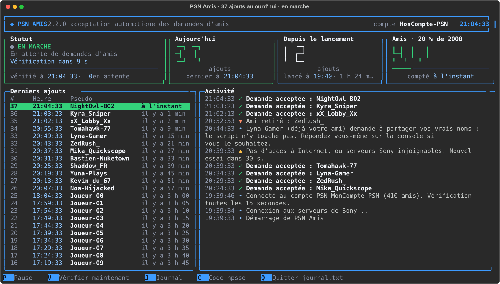
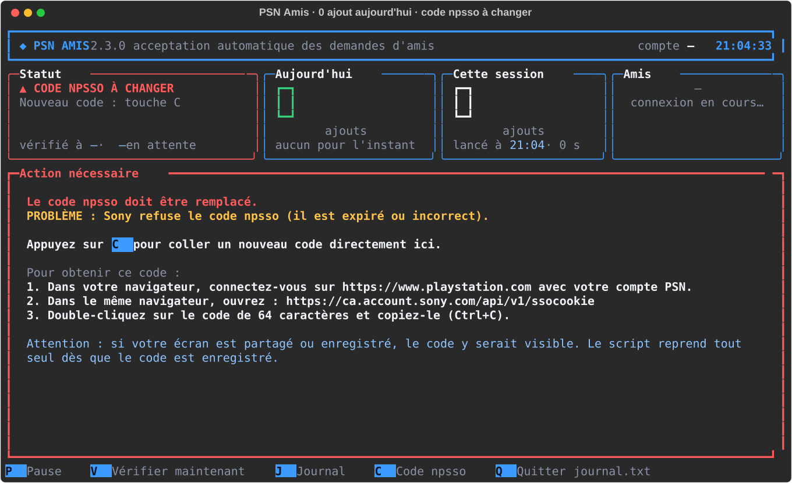
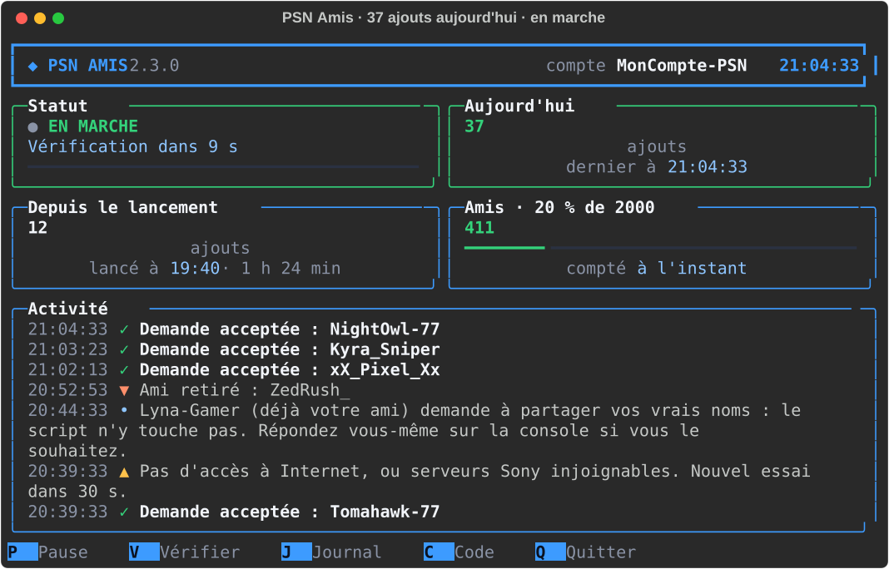
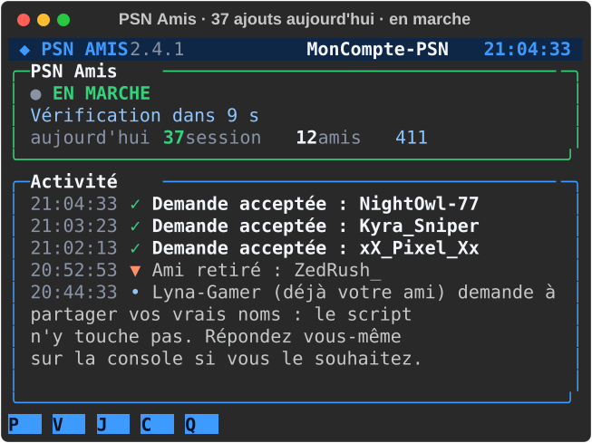

# PSN Amis

**Accepte à ta place les demandes d'amis PlayStation Network, et te montre tout dans une console en couleur.**

[](https://github.com/LASCAMPIA67/psn-amis/actions/workflows/verification.yml)
[](https://github.com/LASCAMPIA67/psn-amis/releases/latest)
[](LICENSE)


[](https://github.com/astral-sh/uv)
[](https://github.com/astral-sh/ruff)



## Sommaire

- [Ce que fait PSN Amis](#ce-que-fait-psn-amis)
- [Ce qu'il te faut](#ce-quil-te-faut)
- [Installation](#installation)
- [La première fois : connecter ton compte PlayStation](#la-première-fois--connecter-ton-compte-playstation)
- [Utilisation](#utilisation)
- [Toutes les 15 secondes](#toutes-les-15-secondes)
- [Réglages](#réglages)
- [Sécurité et vie privée](#sécurité-et-vie-privée)
- [Limites et avertissement](#limites-et-avertissement)
- [Dépannage](#dépannage)
- [Questions fréquentes](#questions-fréquentes)
- [Pour les développeurs](#pour-les-développeurs)
- [Contribuer](#contribuer)
- [Licence et avertissement](#licence-et-avertissement)

## Ce que fait PSN Amis

Dès que quelqu'un t'envoie une demande d'ami sur PlayStation Network, PSN Amis l'accepte pour toi, en quelques secondes, sans que tu aies à ouvrir la console ou l'appli PS App. Il tourne dans une fenêtre sur ton PC, que tu laisses ouverte aussi longtemps que tu veux, et il te montre ce qu'il fait :

- **Il accepte les demandes d'amis reçues**, toutes les 15 secondes, une par une, avec une petite pause entre chaque.
- **Il te montre tout en direct** dans une console en couleur : le statut, les ajouts du jour en gros chiffres, les ajouts depuis le lancement, le nombre d'amis avec une jauge sur 2 000, les derniers ajouts avec l'heure, et un fil d'activité.
- **Il recompte tes amis** auprès de Sony à chaque vérification, et note chaque ami qui n'y est plus (« ▼ Ami retiré »).
- **Il écrit tout dans `journal.txt`**, avec la date et l'heure : tu peux retrouver qui a été ajouté, et quand.
- **Il ne s'arrête jamais tout seul.** Coupure Internet, serveurs Sony en panne, code expiré, liste d'amis pleine… il explique ce qui se passe, attend, et réessaie.
- **Il reste léger** : priorité basse, deux requêtes toutes les 15 secondes. Les autres programmes passent avant lui.
- **Il s'adapte à la fenêtre** : grand écran, fenêtre réduite ou zoom (<kbd>Ctrl</kbd> + molette), l'affichage se réorganise et les messages restent entiers.

Et ce qu'il ne fait **jamais** : retirer un ami, accepter une demande de partage du vrai nom, envoyer quoi que ce soit ailleurs que chez Sony, ou afficher ton code de connexion.

## Ce qu'il te faut

- Un PC sous **Windows 10 ou 11**. [Windows Terminal](https://aka.ms/terminal), fourni avec Windows 11, est conseillé pour l'affichage.
- **Un compte PlayStation Network** : le tien. PSN Amis se connecte au compte dont tu lui donnes le code (voir [La première fois](#la-première-fois--connecter-ton-compte-playstation)) ; rien dans le programme n'est lié au compte de l'auteur.
- [**uv**](https://docs.astral.sh/uv/), gratuit : il installe tout seul Python 3.15 et les bibliothèques, dans le dossier de PSN Amis, sans toucher au reste de ton PC. Dans PowerShell :

  ```powershell
  winget install --id=astral-sh.uv -e
  ```

  Ou, sans winget : `powershell -ExecutionPolicy ByPass -c "irm https://astral.sh/uv/install.ps1 | iex"`. Ferme puis rouvre la fenêtre PowerShell après l'installation.

## Installation

1. Télécharge la [dernière version publiée](https://github.com/LASCAMPIA67/psn-amis/releases/latest) (`Source code (zip)`), puis décompresse-la où tu veux, par exemple dans `Documents\PSN Amis` : clic droit sur le fichier téléchargé, puis **Extraire tout**.
2. Double-clique sur **`Lancer PSN Amis.cmd`**. La première fois, il installe Python et les bibliothèques (quelques dizaines de secondes, avec Internet), puis te demande ton code npsso : c'est l'étape suivante. Les fois suivantes, il vérifie en un instant que tout est à jour, puis ouvre le tableau de bord.

> [!NOTE]
> Comme pour tout fichier téléchargé, Windows peut demander une confirmation à la première ouverture du `.cmd` : clique sur **Exécuter**. Si rien ne se passe, fais un clic droit sur le fichier, **Propriétés**, coche **Débloquer**, puis réessaie.

**Pour le retrouver facilement :** clic droit sur `Lancer PSN Amis.cmd`, **Envoyer vers › Bureau (créer un raccourci)**.

**Pour le mettre à jour :** quitte PSN Amis (<kbd>Q</kbd> deux fois), télécharge la nouvelle version et décompresse-la au même endroit, en remplaçant les fichiers, puis relance : le lanceur met à jour les bibliothèques tout seul. `npsso.txt` et `journal.txt` ne sont pas dans l'archive : ils sont gardés.

**Pour le désinstaller :** quitte PSN Amis et supprime son dossier. Rien d'autre n'est installé, à part uv et le Python qu'il a téléchargé (`uv python uninstall 3.15` pour s'en défaire aussi).

**Depuis le code source :** `git clone https://github.com/LASCAMPIA67/psn-amis.git`, puis le même double-clic.

## La première fois : connecter ton compte PlayStation

PSN Amis parle à Sony en ton nom. Pour cela, il lui faut ton **code npsso** : une suite de 64 lettres et chiffres que Sony donne à ton navigateur quand tu es connecté à playstation.com. Ce code vaut une clé de ton compte, et il reste valable environ deux mois.

C'est à faire une seule fois (puis tous les deux mois environ), et **c'est ce qui décide du compte connecté** : donne le code de ton compte, et c'est ton compte que PSN Amis gère.

> [!WARNING]
> Ne fais pas cette étape si ton écran est partagé ou enregistré : le code y serait visible. Ne le donne à personne et ne le colle nulle part ailleurs : qui a ce code a ton compte.

1. Dans ton navigateur, connecte-toi sur [playstation.com](https://www.playstation.com) avec le compte que les joueurs doivent ajouter.
2. Dans le même navigateur, ouvre <https://ca.account.sony.com/api/v1/ssocookie>. La page affiche une ligne du genre `{"npsso":"aB3x…"}`.
3. Double-clique sur la longue suite de lettres et de chiffres : elle se sélectionne en entier. Copie-la (<kbd>Ctrl</kbd> + <kbd>C</kbd>).
4. Dans la fenêtre de PSN Amis, colle-la (<kbd>Ctrl</kbd> + <kbd>V</kbd>) à l'invite « Collez votre code npsso », puis appuie sur <kbd>Entrée</kbd>. Rien ne s'affiche pendant la saisie, c'est normal. PSN Amis vérifie le code, l'enregistre et se connecte : ton pseudo apparaît en haut à droite du tableau de bord.

Le code est enregistré dans `npsso.txt`, dans le dossier de PSN Amis, lisible seulement par ton compte Windows. Il n'est jamais affiché, jamais écrit dans le journal, et Git l'ignore (`.gitignore`) : il ne peut pas être publié par erreur.

**Pour changer de compte, ou mettre un nouveau code :** appuie sur <kbd>C</kbd> dans le tableau de bord et colle le nouveau code. PSN Amis se reconnecte aussitôt à ce compte. Quand le code expire, un panneau rouge **« Action nécessaire »** te le dit et te guide.



## Utilisation

Double-clique sur **`Lancer PSN Amis.cmd`** et laisse la fenêtre ouverte tant que tu veux que les demandes soient acceptées. Ce que tu vois :

- **En haut :** la version, le compte connecté et l'heure.
- **Statut :** le voyant vert bat quand tout va bien, avec le compte à rebours jusqu'à la prochaine vérification. En cas de souci, la couleur change et une phrase dit quoi faire.
- **Aujourd'hui :** les ajouts du jour, en gros chiffres. Ce compteur est relu dans le journal au démarrage : il ne repart pas à zéro si tu relances.
- **Depuis le lancement :** les ajouts de cette session.
- **Amis :** ton nombre d'amis selon Sony, avec une jauge qui passe à l'orange puis au rouge en approchant de la limite de 2 000.
- **Derniers ajouts :** heure et pseudo de chacun. Un nouvel ajout reste surligné en vert dix secondes.
- **Activité :** ✓ vert pour un ajout, ▼ orange pour un ami retiré, ▲ jaune pour un souci passager, ✗ rouge pour un problème. Chaque message est affiché en entier ; ceux des jours précédents sont datés.

Le **titre de la fenêtre** indique le nombre d'ajouts du jour, visible depuis la barre des tâches.

Si la fenêtre est petite, ou si tu zoomes, l'affichage se resserre : cartes compactes, puis simple résumé.





### Touches

| Touche | Action |
| --- | --- |
| <kbd>P</kbd> | mettre en pause : les nouvelles demandes attendent. <kbd>P</kbd> à nouveau pour reprendre |
| <kbd>V</kbd> | vérifier les demandes et recompter les amis tout de suite |
| <kbd>J</kbd> | ouvrir `journal.txt` dans le Bloc-notes |
| <kbd>C</kbd> | changer le code npsso (donc de compte), sans quitter |
| <kbd>Q</kbd> deux fois | quitter. Fermer la fenêtre fonctionne aussi, et l'arrêt est noté dans le journal |

### En ligne de commande

Dans PowerShell, depuis le dossier de PSN Amis :

```powershell
.\.venv\Scripts\python.exe accepter_amis.py --test         # affiche les demandes en attente, sans rien accepter
.\.venv\Scripts\python.exe accepter_amis.py --simple       # affichage texte simple, sans tableau de bord
.\.venv\Scripts\python.exe accepter_amis.py --configurer   # enregistre le code npsso, puis s'arrête
```

## Toutes les 15 secondes

1. **Les demandes d'amis reçues sont acceptées**, une par une, avec 2 secondes de pause entre chaque. Une demande que Sony refuse (par exemple parce que la liste d'amis de l'autre joueur est pleine) est réessayée 30 minutes plus tard, sans bloquer les suivantes.
2. **La liste d'amis est recomptée.** Chaque ami qui n'y est plus donne une ligne « ▼ Ami retiré : pseudo », qu'il t'ait retiré ou que tu l'aies retiré toi-même : Sony ne dit pas qui l'a fait.
3. **Les demandes de partage du vrai nom**, envoyées par des joueurs déjà amis, sont mises à part : jamais acceptées (elles dévoileraient ton identité), signalées une seule fois. Réponds-y toi-même sur la console si tu le souhaites.

Si ta liste d'amis est pleine, PSN Amis le dit clairement et reprend tout seul dès qu'une place se libère. Il ne retire jamais d'amis : c'est à toi de le faire, sur la console ou dans l'appli PS App.

Tout est écrit dans `journal.txt` (date, heure, pseudo). Quand ce fichier dépasse 1 Mo, il est archivé (`journal.txt.1`, jusqu'à 3 archives).

## Réglages

Tous les réglages sont en haut de `moteur.py`, avec une explication pour chacun :

| Réglage | Par défaut | Rôle |
| --- | --- | --- |
| `INTERVALLE_VERIFICATION` | `15` | secondes entre deux vérifications (demandes, puis liste d'amis) |
| `PAUSE_ENTRE_ACCEPTATIONS` | `2` | secondes de pause entre deux acceptations |
| `DELAI_RESEAU` | `20` | secondes d'attente maximum pour une réponse de Sony |
| `ATTENTE_MAX_APRES_ERREUR` | `300` | attente maximum entre deux essais après des erreurs répétées (5 min) |
| `ATTENTE_SI_TROP_DE_REQUETES` | `900` | pause si Sony demande de ralentir (15 min) |
| `REESSAI_CODE_REFUSE` | `1800` | nouvel essai d'un code refusé, même inchangé (30 min) |
| `DUREE_MISE_DE_COTE` | `1800` | un joueur refusé par Sony est réessayé 30 min plus tard |
| `LIMITE_AMIS_PSN` | `2000` | nombre maximum d'amis sur un compte PSN |
| `MARGE_ACCES` | `120` | l'autorisation d'accès Sony (1 h) est renouvelée 2 min avant la fin |
| `MARGE_RENOUVELLEMENT` | `3600` | reconnexion 1 h avant l'expiration de la session Sony (2 mois) |
| `NOMBRE_MAX_RETRAITS_DETAILLES` | `10` | au-delà, les amis retirés d'un coup sont résumés |

Garde un rythme raisonnable : PSNAWP, la bibliothèque utilisée, se limite elle-même à 300 requêtes par quart d'heure. Avec les réglages par défaut, PSN Amis en fait 8 par minute quand il ne se passe rien, plus 2 par acceptation.

## Sécurité et vie privée

- **Ton code npsso ne quitte jamais ton PC**, sauf vers les serveurs d'authentification de Sony. Il n'est ni affiché, ni journalisé : s'il apparaissait par accident dans un message, il serait remplacé par `[code masqué]`.
- **Seuls les serveurs de Sony** (`sony.com`, `playstation.com`, `playstation.net`) peuvent être contactés. Toute autre adresse est bloquée avant l'envoi. Aucune télémétrie.
- **PSN Amis ne retire jamais d'amis** et n'accepte jamais une demande de partage du vrai nom.
- **`journal.txt` contient des pseudos** de joueurs : ne le publie pas tel quel.
- **Si tu partages ou enregistres ton écran**, les pseudos des joueurs acceptés sont visibles ; le code npsso, lui, ne l'est jamais. N'utilise pas l'assistant de connexion (<kbd>C</kbd>) pendant ce temps.
- Une seule copie de PSN Amis tourne à la fois.

Le détail de ce que fait le programme est dans [SECURITY.md](SECURITY.md).

## Limites et avertissement

- PSN Amis utilise [PSNAWP](https://github.com/isFakeAccount/psnawp), une bibliothèque **non officielle** qui parle à Sony comme le fait l'appli PS App. Sony peut changer ses serveurs sans prévenir, et son règlement n'autorise pas forcément l'automatisation : un compte qui fait trop de requêtes peut être suspendu. PSN Amis garde un rythme modéré, mais **tu l'utilises sous ta responsabilité**.
- Un compte PSN ne peut pas avoir plus de 2 000 amis : au-delà, Sony refuse les nouvelles demandes.
- PSN Amis fonctionne sous Windows (il utilise la console Windows pour les touches et l'affichage).
- Il gère un seul compte à la fois : pour un deuxième compte, fais une deuxième copie du dossier, avec son propre `npsso.txt`.

## Dépannage

**Un panneau rouge « Action nécessaire » : le code npsso est refusé ou expiré.** C'est normal environ tous les deux mois. Appuie sur <kbd>C</kbd>, et suis les quatre étapes affichées (voir [La première fois](#la-première-fois--connecter-ton-compte-playstation)). PSN Amis reprend tout seul.

**« PSN Amis tourne déjà dans une autre fenêtre. »** Il est déjà ouvert : cherche sa fenêtre dans la barre des tâches. Si tu es sûr qu'il ne tourne nulle part (après un plantage de Windows, par exemple), supprime le fichier `accepter_amis.lock` du dossier, puis relance.

**« Première utilisation : installation des composants » échoue, ou « L'outil uv est introuvable ».** Installe [uv](#ce-quil-te-faut), ferme toutes les fenêtres PowerShell ou de terminal, puis relance `Lancer PSN Amis.cmd`. L'installation a besoin d'Internet.

**Les symboles ou les couleurs s'affichent mal.** Utilise Windows Terminal : **Paramètres › Système › Pour les développeurs › Terminal**, choisis **Terminal Windows**. L'ancienne console de Windows marche aussi, mais avec moins de finesse.

**« Demande de X refusée par Sony ».** Le plus souvent, c'est la liste d'amis de ce joueur qui est pleine : PSN Amis réessaie 30 minutes plus tard, tu n'as rien à faire. Si c'est ta liste qui est pleine, le statut l'indique en rouge.

**« LISTE D'AMIS PLEINE ».** Retire des amis sur la console ou dans l'appli PS App. PSN Amis reprend tout seul dès qu'il y a de la place.

**« Pas d'accès à Internet, ou serveurs Sony injoignables. »** PSN Amis réessaie tout seul, de plus en plus espacé (30 s, 1 min, 2 min, jusqu'à 5 min). <kbd>V</kbd> force un essai immédiat.

**Un « Ami retiré » alors que je n'ai rien fait.** Le joueur t'a retiré de ses amis, ou a été banni. Sony met parfois quelques minutes à refléter un changement.

**J'ai mis un nouveau code, mais le compte affiché est l'ancien.** Appuie sur <kbd>C</kbd> et colle le code du bon compte : le pseudo en haut à droite change après la reconnexion. Le code vient du navigateur où tu es connecté : vérifie que c'est le bon compte qui y est ouvert.

**La fenêtre se ferme tout de suite.** Lance `Lancer PSN Amis.cmd` depuis PowerShell pour lire le message : `& ".\Lancer PSN Amis.cmd"`. Le plus souvent, uv manque, ou l'installation n'a pas pu se faire.

## Questions fréquentes

**Dois-je donner mon mot de passe PlayStation ?** Non, jamais. PSN Amis ne te demande que le code npsso, que tu copies toi-même depuis ton navigateur. Il ne connaît pas ton mot de passe.

**Est-ce que ça marche avec mon compte, et pas celui de l'auteur ?** Oui : c'est le code npsso que tu colles qui décide du compte. Le dépôt ne contient aucun code, et `npsso.txt` est ignoré par Git. Le pseudo du compte connecté est affiché en haut du tableau de bord.

**PS4 ou PS5 ?** Les deux : les amis sont liés au compte, pas à la console.

**Et si je ferme la fenêtre ?** Plus rien n'est accepté. Relance PSN Amis, et les demandes arrivées entre-temps sont acceptées dans les 15 secondes. Le compteur du jour est relu dans le journal.

**Puis-je le laisser tourner toute la journée ?** Oui, c'est fait pour. Il renouvelle lui-même ses autorisations auprès de Sony ; seul le code npsso est à refaire tous les deux mois environ.

**Pourquoi un fichier `.cmd` et pas un `.exe` ?** Un `.exe` fabriqué à partir d'un script Python est souvent bloqué à tort par les antivirus, et il faudrait le refabriquer à chaque changement. Le `.cmd` lance simplement le programme, dont tu peux lire tout le code.

**Linux ou macOS ?** Pas pour l'instant : le tableau de bord s'appuie sur la console Windows.

## Pour les développeurs

Le projet est géré avec [uv](https://docs.astral.sh/uv/) (Python 3.15, versions figées dans `uv.lock`) et vérifié par [Ruff](https://docs.astral.sh/ruff/) et [pytest](https://docs.pytest.org/).

```shell
uv sync                              # Python 3.15, bibliothèques et outils de développement
uv run ruff check .                  # qualité du code
uv run ruff format .                 # mise en forme
uv run pytest                        # tests, sans Internet ni vrai compte (environ 30 s)
uv run outils/verifier_version.py    # même version partout
uv run outils/captures.py            # redessine les captures d'écran (données inventées)
```

| Fichier | Rôle |
| --- | --- |
| `accepter_amis.py` | point d'entrée : options, verrou, assistant de connexion, fin de session |
| `moteur.py` | Sony : connexion, demandes, acceptations, recomptage ; état partagé ; réglages |
| `tableau_de_bord.py` | affichage Rich, mise en page selon la taille, clavier |
| `Lancer PSN Amis.cmd` | le lanceur à double-cliquer (installe tout la première fois) |
| `tests/` | tests pytest, avec un faux Sony en mémoire |
| `outils/` | captures d'écran, notes de version, contrôle de version |
| `docs/images/` | les captures d'écran du README |

Les vérifications automatiques tournent sur GitHub à chaque envoi (`verification.yml`) ; une étiquette `vX.Y.Z` publie la version (`publication.yml`). Le détail est dans le [guide de contribution](CONTRIBUTING.md).

## Contribuer

Les idées et les corrections sont les bienvenues ! Lis le [guide de contribution](CONTRIBUTING.md) et le [code de conduite](CODE_OF_CONDUCT.md). Pour une question, passe par les [discussions](https://github.com/LASCAMPIA67/psn-amis/discussions). Les changements de chaque version sont dans le [journal des modifications](CHANGELOG.md).

## Licence et avertissement

PSN Amis est distribué sous [licence MIT](LICENSE).

PSN Amis n'est affilié ni à Sony Interactive Entertainment, ni au projet PSNAWP. « PlayStation », « PlayStation Network », « PS4 » et « PS5 » sont des marques de Sony Interactive Entertainment.
